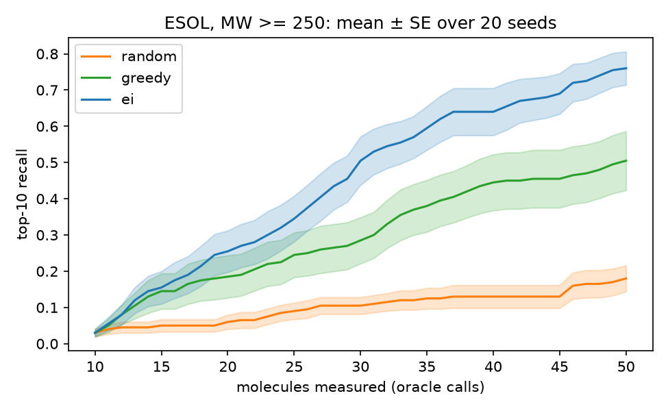
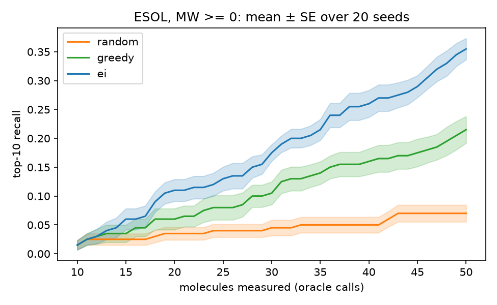

# Bayesian Optimization for Molecular Discovery

A pool-based Bayesian optimization (BO) loop that finds highly water-soluble molecules while measuring only a small fraction of the candidates.

With a budget of 50 measurements, BO finds **76% of the 10 most soluble molecules** in a pool of 350 molecules with molecular weight (MW) ≥ 250 g/mol, after measuring only 14% of it. Greedy search finds 51% and random search finds 18%.

<p align="center">
  
</p>

## Motivation

Discovering molecules and materials with desired properties is limited by the cost of evaluation: each candidate must be characterized by a wet-lab assay or a physics simulation such as density functional theory, which can take hours to days. Because the candidate space far exceeds what can be measured exhaustively, the central question is which candidate to evaluate next. Bayesian optimization addresses this by fitting a probabilistic surrogate model to the measurements collected so far and using an acquisition function to balance exploitation of regions the model predicts to be promising against exploration of regions where it is uncertain. Iterating this selection, measurement, and model update forms a closed design-make-test loop that can locate high-performing candidates with far fewer evaluations than exhaustive or random screening. This project implements such a loop on a retrospective solubility benchmark, where hidden experimental labels serve as the oracle, and tests whether the surrogate's uncertainty estimates improve discovery beyond what its predictions alone achieve.

## Results

20 random seeds, budget of 50 measurements (10 random initial picks + 40 chosen by the strategy). Values are top-10 recall at the end of the budget, mean ± standard error. BO is labeled `ei` in the code and plots.

| Setting | Pool size | Budget / pool | Random | Greedy | **BO (LogEI)** |
|---|---|---|---|---|---|
| MW ≥ 250 g/mol | 350 | 14% | 0.180 ± 0.036 | 0.505 ± 0.082 | **0.760 ± 0.046** |
| All molecules (after dedup) | 1,115 | 4.5% | 0.070 ± 0.015 | 0.215 ± 0.023 | **0.355 ± 0.018** |

<p align="center">
  
</p>

### Findings

- **BO beats random search** by 4.2x (filtered pool) and 5.1x (full pool) in top-10 recall.
- **Using uncertainty helps.** BO beats greedy, which uses the same GP but ranks by posterior mean alone, by 0.255 and 0.14 recall (about 2.7 and 4.8 standard errors, computed as unpaired sqrt(SE₁² + SE₂²)).
- **BO is more reliable.** It found a new top-10 molecule in all 20 runs in both settings; greedy failed to in 5 of 20 runs on the filtered pool and 2 of 20 on the full pool.
- **Sanity check.** Random search recovers about the fraction of the pool it measures (0.18 vs. 0.14, 0.07 vs. 0.045).
- **Compare settings by ratios, not absolute recall.** The budget covers 14% of the filtered pool but only 4.5% of the full pool.

## Problem setup

- **Dataset:** [ESOL](https://pubs.acs.org/doi/10.1021/ci034243x) (Delaney, 2004), 1,128 entries (1,115 unique molecules after merging duplicates) with measured aqueous solubility (log mol/L).
- **Objective:** maximize log solubility.
- **Oracle:** the labels exist but are hidden. A strategy sees a molecule's solubility only after it chooses to "measure" it. This is a standard retrospective benchmark for BO.
- **Feasibility filter:** molecular weight (MW) ≥ 250 g/mol by default. Without it, the most soluble molecules are tiny ones such as methanol and acetamide (9 of the overall top 10 have MW below 200), which is not an interesting discovery target. MW is known from the structure before any measurement (read from the dataset, with an RDKit fallback), so it is applied as a filter on the pool before the search starts. This is plain BO on a filtered pool, not constrained BO, since no constraint is modeled.
- **Metric:** top-k recall, the fraction of the true top-10 molecules found so far. Unlike "best value found", it does not saturate after one lucky hit, so it separates strategies more clearly.

## Method

| Component | Choice | Reason |
|---|---|---|
| Representation | 2048-bit Morgan fingerprints, radius 2 (RDKit) | Standard, fast molecular features |
| Surrogate | Gaussian process with a Tanimoto kernel | Tanimoto similarity is the natural similarity for binary fingerprints, as used in [GAUCHE](https://arxiv.org/abs/2212.04450) |
| Acquisition | Log Expected Improvement (BoTorch) | Numerically stable version of EI |
| Baselines | Random search; greedy (posterior mean only) | Random tests whether the model helps; greedy tests whether uncertainty helps |
| Search | Pool-based: score every unmeasured molecule, pick the best | Matches virtual screening of a fixed library |

For fair comparison, all strategies start from the same 10 random molecules for a given seed.

### Data cleaning

- Duplicate molecules are merged and their labels averaged (13 merges in total).
- ESOL already gives some stereoisomers the same SMILES, so they merge as exact duplicates. For example, mannitol (logS 0.06) and sorbitol (logS 1.09) are averaged to 0.575.
- Duplicates are also detected without stereochemistry, because Morgan fingerprints do not encode it, so stereoisomers would otherwise be identical inputs with different labels. This adds 2 merges (cis/trans-2-pentene, crotonaldehyde/2-butenal).
- Invalid SMILES, missing labels, and molecules with an all-zero fingerprint are dropped (none in ESOL).
- If a GP fit fails, that step falls back to a GP with default hyperparameters. Failures and optimizer warnings are counted in `summary.csv` (0 in the reported runs).

## Reproduce

Requires [Miniforge](https://github.com/conda-forge/miniforge).

```bash
git clone https://github.com/<your-username>/bo-molecular-discovery.git
cd bo-molecular-discovery
mamba env create -f environment.yml
conda activate bo-esol

# Filtered pool (MW >= 250), about 4 minutes on an HPC CPU node
python bo_esol.py --out results/mw250

# Full pool, about 8 minutes on an HPC CPU node
python bo_esol.py --mw-min 0 --out results/all

# Quick check, about a minute
python bo_esol.py --seeds 3 --out /tmp/check
```

The script downloads ESOL automatically. To use a local copy, pass `--data path/to/delaney-processed.csv`.

### Outputs

| File | Content |
|---|---|
| `recall.png` | Top-k recall vs. molecules measured, mean ± standard error |
| `summary.csv` | Per strategy: final recall ± SE, gain over the initial set, runs with a new top-k hit, GP fit failures and warnings, runtime |
| `run_info.json` | Arguments, data cleaning counts, top-k set size, and logS threshold |
| `curves.npz` | Per-seed recall curves (not committed to the repo) |

### Options

| Flag | Default | Meaning |
|---|---|---|
| `--data` | DeepChem ESOL URL | URL or local path to the ESOL CSV |
| `--out` | `results` | Output directory |
| `--mw-min` | 250 | MW filter in g/mol; 0 disables it |
| `--budget` | 50 | Total measurements, including the initial set |
| `--n-init` | 10 | Random initial measurements |
| `--top-k` | 10 | Size of the target set (ties at the cutoff are included) |
| `--seeds` | 20 | Number of repeated runs |
| `--strategies` | random greedy ei | Any subset of random, greedy, ei |

The script requires `1 <= n_init < budget <= pool size`, `1 <= top_k <= pool size`, and `seeds >= 2`.

## Limitations

- **Retrospective benchmark.** The oracle is a lookup of known labels, not a real experiment or simulation. Results show how efficient the search is, not how well it discovers new molecules.
- **Fixed pool.** The search only selects from existing molecules. It does not generate new ones.
- **One dataset, one property.** ESOL is small and single-objective.
- **One molecule at a time.** Real labs usually test molecules in batches.

## Future work

The current loop selects one molecule per round, while experimental campaigns typically evaluate candidates in parallel batches. A natural extension is batch acquisition with qLogEI, which would also allow a study of how batch size trades off against the total number of rounds. The benchmark is also retrospective, so I plan to replace the label lookup with a physics-based oracle such as GFN2-xTB, where each query carries a real computational cost and can fail. Finally, the search is restricted to a fixed library of known molecules. Running BO in the latent space of a pretrained molecular generative model would let the loop propose new candidates, at the cost of having to keep generated molecules chemically valid and synthesizable.

## References

- J. S. Delaney. ESOL: Estimating aqueous solubility directly from molecular structure. *J. Chem. Inf. Comput. Sci.* 44(3):1000-1005, 2004.
- M. Balandat et al. BoTorch: A framework for efficient Monte-Carlo Bayesian optimization. *NeurIPS*, 2020.
- R.-R. Griffiths et al. GAUCHE: A library for Gaussian processes in chemistry. *NeurIPS*, 2023.
- S. Ament et al. Unexpected improvements to expected improvement for Bayesian optimization. *NeurIPS*, 2023.

## License

This project is licensed under the MIT License. See [LICENSE](LICENSE) for details.
